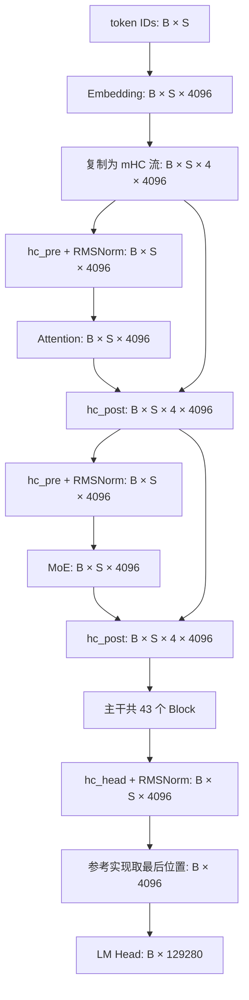

# DeepSeek V4 Flash 模型结构与维度

- [DeepSeek V4 Flash 模型结构与维度](#deepseek-v4-flash-模型结构与维度)
  - [1. 配置与维度约定](#1-配置与维度约定)
    - [1.1 源码版本](#11-源码版本)
    - [1.2 主要参数](#12-主要参数)
  - [2. 整体计算路径](#2-整体计算路径)
  - [3. mHC 残差流](#3-mhc-残差流)
    - [3.1 分支入口](#31-分支入口)
    - [3.2 分支回写](#32-分支回写)
  - [4. Query 与共享 KV](#4-query-与共享-kv)
    - [4.1 Query 投影](#41-query-投影)
    - [4.2 共享 KV 投影](#42-共享-kv-投影)
  - [5. KV 压缩与索引](#5-kv-压缩与索引)
    - [5.1 Attention 层分配](#51-attention-层分配)
    - [5.2 Compressor](#52-compressor)
    - [5.3 CSA 的 Indexer](#53-csa-的-indexer)
    - [5.4 HCA 的可见范围](#54-hca-的可见范围)
  - [6. 稀疏 Attention 与输出投影](#6-稀疏-attention-与输出投影)
    - [6.1 Attention 与 Sink](#61-attention-与-sink)
    - [6.2 分组输出投影](#62-分组输出投影)
  - [7. MoE 计算](#7-moe-计算)
    - [7.1 路由与专家选择](#71-路由与专家选择)
    - [7.2 专家 FFN](#72-专家-ffn)
  - [8. 输出头与 MTP](#8-输出头与-mtp)
    - [8.1 主干输出](#81-主干输出)
    - [8.2 MTP 分支](#82-mtp-分支)
  - [9. Prefill、Decode 与缓存](#9-prefilldecode-与缓存)
  - [10. 维度检查](#10-维度检查)
  - [参考资料](#参考资料)

对照官方配置与推理代码，沿一次前向计算梳理张量形状。基础算子实现见 [LLM 核心算子手撕](../llm-operator-implementations/index.md)。

## 1. 配置与维度约定

### 1.1 源码版本

模型为 `deepseek-ai/DeepSeek-V4-Flash`，固定 revision：

```text
60d8d70770c6776ff598c94bb586a859a38244f1
```

| 文件 | 用途 |
|------|------|
| [config.json](https://huggingface.co/deepseek-ai/DeepSeek-V4-Flash/blob/60d8d70770c6776ff598c94bb586a859a38244f1/config.json) | Hugging Face 模型参数 |
| [inference/config.json](https://huggingface.co/deepseek-ai/DeepSeek-V4-Flash/blob/60d8d70770c6776ff598c94bb586a859a38244f1/inference/config.json) | 参考实现使用的参数名与取值 |
| [inference/model.py](https://huggingface.co/deepseek-ai/DeepSeek-V4-Flash/blob/60d8d70770c6776ff598c94bb586a859a38244f1/inference/model.py) | Transformer、mHC、Attention、Compressor、MoE、MTP |
| [inference/kernel.py](https://huggingface.co/deepseek-ai/DeepSeek-V4-Flash/blob/60d8d70770c6776ff598c94bb586a859a38244f1/inference/kernel.py) | Sparse Attention 与 Sinkhorn 归一化 |

下文使用**单进程、未切分的逻辑维度**。权重按 PyTorch 的 `[out_features,in_features]` 表示；FP4 打包与量化 scale 另计。`B` 为 batch size，`S` 为本次输入长度，`L` 为包含历史的有效长度，`T=B·S`。

### 1.2 主要参数

取值来自上述两个配置文件，字段对应如下。

| HF 字段 / 参考实现字段 | 值 | 含义 |
|------|------|------|
| `vocab_size` | 129280 | 词表大小 V |
| `hidden_size` / `dim` | 4096 | 主干宽度 D |
| `num_hidden_layers` / `n_layers` | 43 | 主干 Block 数 |
| `hc_mult` | 4 | mHC 残差流数量 M |
| `num_attention_heads` / `n_heads` | 64 | Query head 数 H |
| `num_key_value_heads` | 1 | 共享 KV |
| `head_dim` | 512 | 每个 Query / KV 向量宽度 d |
| `qk_rope_head_dim` / `rope_head_dim` | 64 | RoPE 维度；其余 448 维不旋转 |
| `q_lora_rank` | 1024 | Query 中间宽度 Rq |
| `o_groups` / `o_lora_rank` | 8 / 1024 | 输出分组数 G / 每组中间宽度 Ro |
| `sliding_window` / `window_size` | 128 | 原始 KV 滑窗 W |
| `index_n_heads` / `index_head_dim` | 64 / 128 | Indexer 的 head 数与维度 |
| `index_topk` | 512 | CSA 最多选择的压缩 KV 条数 |
| `n_routed_experts` / `n_shared_experts` | 256 / 1 | 路由专家 / 共享专家数量 |
| `num_experts_per_tok` / `n_activated_experts` | 6 | 每 token 选择的路由专家数 |
| `moe_intermediate_size` / `moe_inter_dim` | 2048 | 单个专家的中间宽度 F |
| `num_hash_layers` / `n_hash_layers` | 3 | 使用 token ID 查表选专家的前几层 |
| `num_nextn_predict_layers` / `n_mtp_layers` | 1 | MTP 层数 |
| `max_position_embeddings` | 1048576 | 模型上下文长度配置 |

**d 不等于 D/H**：`4096/64=64`，但这里的 head dimension 为 512；Query 投影后总宽度为 `64×512=32768`。mHC 的 4 路流也不是 4 个 Attention heads。

`ModelArgs` 的类默认值用于小规模运行，实际模型尺寸以配置文件为准。参考实现的缓存上限还受 `max_seq_len` 控制，其默认值为 4096，和模型支持的上下文长度是两个配置层次。

## 2. 整体计算路径

主干从 token ID 出发，Embedding 后扩展为 4 路残差流；每个 Block 内，Attention 和 MoE 分支各处理一个 4096 维向量，再写回 4 路流。对应 [Transformer.forward](https://huggingface.co/deepseek-ai/DeepSeek-V4-Flash/blob/60d8d70770c6776ff598c94bb586a859a38244f1/inference/model.py#L801) 和 [Block.forward](https://huggingface.co/deepseek-ai/DeepSeek-V4-Flash/blob/60d8d70770c6776ff598c94bb586a859a38244f1/inference/model.py#L688)。



Embedding 权重为 `[129280,4096]`。初始的 4 路流由同一 Embedding 复制而来，经过后续混合后可以不同；Attention 和 FFN 的输入宽度仍是 4096。

## 3. mHC 残差流

### 3.1 分支入口

设残差状态 `X[B,S,4,4096]`。`hc_pre` 先计算混合系数，再沿流维加权汇聚。对应 [Block.hc_pre](https://huggingface.co/deepseek-ai/DeepSeek-V4-Flash/blob/60d8d70770c6776ff598c94bb586a859a38244f1/inference/model.py#L673)。

| 步骤 | 输入 | 输出 |
|------|------|------|
| 展平流维与特征维 | `[B,S,4,4096]` | `[B,S,16384]` |
| 混合投影，权重 `[24,16384]` | `[B,S,16384]` | `mixes[B,S,24]` |
| 拆分并施加约束 | `[B,S,24]` | `pre[B,S,4]`、`post[B,S,4]`、`comb[B,S,4,4]` |
| 用 pre 汇聚 4 路流 | `[B,S,4,4096]` | `Z[B,S,4096]` |
| 分支 RMSNorm | `[B,S,4096]` | `[B,S,4096]` |

24 来自 `2M+M²=4+4+16`。混合投影的结果还乘以展平输入的 RMS 倒数，然后加上学习到的 scale/base，产生三组系数：

$$
Z_{b,t,:}=\sum_{i=0}^{3}\operatorname{pre}_{b,t,i}X_{b,t,i,:}.
$$

在 [hc_split_sinkhorn_kernel](https://huggingface.co/deepseek-ai/DeepSeek-V4-Flash/blob/60d8d70770c6776ff598c94bb586a859a38244f1/inference/kernel.py#L372) 中，pre 使用 `sigmoid+eps`，post 使用 `2·sigmoid`，comb 经行、列交替归一化。配置的 Sinkhorn 迭代数为 20；comb 近似满足双随机约束，pre/post 不要求各自求和为 1。

### 3.2 分支回写

分支结果 `F(Z)[B,S,4096]` 按 post 写入各流，同时用 comb 混合旧残差：

$$
Y_{b,t,j,:}=\operatorname{post}_{b,t,j}F(Z)_{b,t,:}
+\sum_i\operatorname{comb}_{b,t,i,j}X_{b,t,i,:}.
$$

此处 comb 的第一个流下标是输入流，第二个是输出流，与 [hc_post](https://huggingface.co/deepseek-ai/DeepSeek-V4-Flash/blob/60d8d70770c6776ff598c94bb586a859a38244f1/inference/model.py#L683) 的归约轴一致。结果恢复为 `[B,S,4,4096]`。

一个 Block 对 Attention、MoE 各执行一组 pre/post，使用不同参数。

## 4. Query 与共享 KV

以下 X 指 Attention 分支经过 RMSNorm 后的 `[B,S,4096]`。Attention 使用共享 KV 的 MQA，Query 与输出采用低秩投影。对应 [Attention.__init__ / forward](https://huggingface.co/deepseek-ai/DeepSeek-V4-Flash/blob/60d8d70770c6776ff598c94bb586a859a38244f1/inference/model.py#L436)。

### 4.1 Query 投影

| 步骤 | 权重逻辑形状 | 输出 |
|------|------|------|
| `wq_a` | `[1024,4096]` | `[B,S,1024]` |
| `q_norm` | `[1024]` | `qr[B,S,1024]` |
| `wq_b` | `[32768,1024]` | `[B,S,32768]` |
| 拆 head | — | `Q[B,S,64,512]` |
| 每 head 的 RMS 归一化 | 无仿射权重 | `[B,S,64,512]` |
| 最后 64 维施加 RoPE | — | `[B,S,64,512]` |

`qr` 既用于主 Query，也供 CSA 的 Indexer 使用。`q_lora_rank` 表示这里的低秩投影宽度，不是微调时额外插入的 LoRA adapter。

### 4.2 共享 KV 投影

```text
X[B,S,4096]
  -> wkv，权重 [512,4096]
  -> KV[B,S,512]
  -> RMSNorm(512)
  -> 最后 64 维 RoPE
  -> 滑窗 KV / 压缩分支
```

参考 kernel 将同一份 KV 同时用于 key 点积和 value 加权求和，因此缓存中只有一份 `[B,L,512]` 向量序列。512 已包含 `448+64`，不能再额外拼出 576 维。

参考实现对非 RoPE 的 448 维做 FP8 量化模拟，RoPE 部分保留较高精度。量化改变数值表示，逻辑宽度仍为 512。

## 5. KV 压缩与索引

### 5.1 Attention 层分配

根据 `compress_ratios`，**主干层号从 0 开始**：

| 主干层号 | 压缩比 r | 结构 | 层数 |
|------|------|------|------|
| 0、1 | 0 | 仅 Sliding Window Attention | 2 |
| 2、4、…、42 | 4 | 滑窗 + CSA，Indexer 选择压缩 KV | 21 |
| 3、5、…、41 | 128 | 滑窗 + HCA，使用可见压缩 KV | 20 |

配置数组共有 44 项，最后一项为 MTP 层的 0；主干只使用前 43 项。CSA/HCA 的定义与分工参见 [技术报告 §2.3](https://arxiv.org/html/2606.19348v1#S2.SS3)。

### 5.2 Compressor

Compressor 从分支输入 X 直接产生压缩向量，并维护独立的池化状态；压缩的是序列长度，输出向量仍为 512 维。对应 [Compressor](https://huggingface.co/deepseek-ai/DeepSeek-V4-Flash/blob/60d8d70770c6776ff598c94bb586a859a38244f1/inference/model.py#L279)。

| 路径 | KV / gate 投影输出 | 池化前逻辑形状 | 压缩输出 |
|------|------|------|------|
| CSA，r=4 | 各 `[B,S,1024]` | `[B,N4,8,512]` | `[B,N4,512]` |
| HCA，r=128 | 各 `[B,S,512]` | `[B,N128,128,512]` | `[B,N128,512]` |

其中 `Nr=floor(L/r)` 表示已完成的压缩条目数量；表中池化形状描述已完成的分组，尾部未满 r 个 token 时保留在状态缓冲中。

CSA 使用重叠池化：每组覆盖前一组 4 个 token 的 overlap 分量和当前组 4 个 token 的 normal 分量。投影的 1024 维由两组 512 维组成，重排后在 8 个位置上池化；最前面不存在的历史位置被屏蔽。

每个通道有自己的 gate 分数，加上可学习的位置项 APE 后，沿池化位置做 Softmax：

$$
C_{n,c}=\sum_{u\in\mathcal W_n}
\operatorname{softmax}_{u}(g_{n,u,c}+\operatorname{APE}_{u,c})\,v_{n,u,c}.
$$

随后执行 RMSNorm 与部分 RoPE。HCA 不使用上述重叠，直接将 128 个位置池化成一个条目。压缩结果不是 4 个或 128 个向量的直接拼接，也不是固定平均值。

### 5.3 CSA 的 Indexer

CSA 有一套独立的 128 维索引缓存，用于选择主 Attention 的 **512 维压缩 KV**。对应 [Indexer](https://huggingface.co/deepseek-ai/DeepSeek-V4-Flash/blob/60d8d70770c6776ff598c94bb586a859a38244f1/inference/model.py#L380)。

| 步骤 | 输入 | 输出 |
|------|------|------|
| Indexer Query 投影 | `qr[B,S,1024]` | `[B,S,8192] -> [B,S,64,128]` |
| Indexer Compressor | `X[B,S,4096]` | `CI[B,N4,128]` |
| head 权重投影 | `X[B,S,4096]` | `a[B,S,64]` |
| 每 head 的索引点积 | QI 与 CI | `[B,S,64,N4]` |
| ReLU、head 加权求和 | `[B,S,64,N4]` | `score[B,S,N4]` |
| 因果屏蔽、Top-K | `[B,S,N4]` | `indices[B,S,K]`，K≤512 |

Indexer 的 Compressor 同样按 r=4 重叠池化，但向量宽度为 128，因此 KV/gate 投影各输出 256 维。其 Query 和压缩向量还经过 Hadamard 旋转与 FP4 模拟。

将缩放项写开，索引分数为：

$$
I_{t,n}=\sum_{h=0}^{63}\frac{a_{t,h}}{\sqrt{128}\sqrt{64}}
\operatorname{ReLU}\bigl(q^I_{t,h}\cdot c^I_n\bigr).
$$

选出的 indices 由同一 token 的各主 Query heads 共用。128 维只用于找位置，不能拿它替代主 Attention 的 512 维 KV。Indexer 仍需要对压缩序列打分，CSA 的总开销不能只按最终 Top-512 计算。

### 5.4 HCA 的可见范围

HCA 不运行 Indexer。位置 t 只能访问已经完成的压缩组，条数为 `floor((t+1)/128)`。

| 路径 | 单个 Query 的主 Attention 可见条目 |
|------|------|
| 纯滑窗 | 最近最多 128 条原始 KV |
| CSA | 最近最多 128 条原始 KV + 最多 512 条压缩 KV |
| HCA | 最近最多 128 条原始 KV + 全部已完成的 128 倍压缩 KV |

例如 L=1048576 时，HCA 最后一个 Query 可见 8192 条压缩 KV，加上 128 条滑窗，共 8320 条。CSA 最多为 640 条，但另有索引打分成本。

## 6. 稀疏 Attention 与输出投影

### 6.1 Attention 与 Sink

设位置 t 选出的 KV 集合为 `Jt`。每个 head 在这些位置上计算：

$$
s_{h,j}=\frac{q_{h}\cdot KV_j}{\sqrt{512}},\qquad
o_h=\frac{\sum_{j\in J_t}e^{s_{h,j}}KV_j}
{\sum_{j\in J_t}e^{s_{h,j}}+e^{b_h}}.
$$

`b_h` 来自 `attn_sink[64]`。Sink 只增加 Softmax 分母，可视为一个 value 为 0 的额外位置；真实 KV 对应的概率之和可以小于 1。对应 [sparse_attn_kernel](https://huggingface.co/deepseek-ai/DeepSeek-V4-Flash/blob/60d8d70770c6776ff598c94bb586a859a38244f1/inference/kernel.py#L277)。

```text
Q:       [B,S,64,512]
KV:      [B,N,512]
indices: [B,S,K]
scores:  逻辑上为 [B,S,64,K]
O:       [B,S,64,512]
```

kernel 按 indices 取数并维护 Online Softmax 状态，完整 scores 不必落到显存。由于共享 KV 的 value 也含旋转后的通道，Attention 之后还要对 O 的最后 64 维执行当前 Query 位置的 **逆 RoPE**。

### 6.2 分组输出投影

对应 [Attention.forward 的输出部分](https://huggingface.co/deepseek-ai/DeepSeek-V4-Flash/blob/60d8d70770c6776ff598c94bb586a859a38244f1/inference/model.py#L534)：

| 步骤 | 形状 |
|------|------|
| Attention 输出 | `[B,S,64,512]` |
| 64 heads 分为 8 组，每组 8 heads | `[B,S,8,4096]` |
| 每组独立投影，逻辑权重 `[8,1024,4096]` | `[B,S,8,1024]` |
| 合并组维 | `[B,S,8192]` |
| `wo_b`，权重 `[4096,8192]` | `[B,S,4096]` |

`wo_a` 的存储权重为 `[8192,4096]`，计算时解释为 `[8,1024,4096]`。这是 8 个独立的分组投影，不是一个将完整 32768 维输入映射到 8192 维的稠密层。

Attention 分支至此回到 D=4096，再通过 mHC post 回到 `[B,S,4,4096]`。

## 7. MoE 计算

MoE 分支先经自己的 mHC pre 和 RMSNorm，输入 `[B,S,4096]`，展平为 `[T,4096]`。主干 43 层均使用 MoE；前 3 层的区别在于路由方式。对应 [Gate、Expert、MoE](https://huggingface.co/deepseek-ai/DeepSeek-V4-Flash/blob/60d8d70770c6776ff598c94bb586a859a38244f1/inference/model.py#L546)。

### 7.1 路由与专家选择

Router 权重为 `[256,4096]`，产生每 token 的 256 个原始分数：

$$
u=XW_g^T,\qquad s=\sqrt{\operatorname{softplus}(u)}.
$$

| 主干层号 | 专家索引来源 | 路由权重来源 |
|------|------|------|
| 0、1、2 | `tid2eid[token_id]`，查表形状 `[129280,6]` | 仍计算 s，并取对应专家分数 |
| 3～42 | 对 `s+bias` 取 Top-6 | 取未加 bias 的 s |

对选中的 6 个专家，将分数归一化并乘 `routed_scaling_factor=1.5`：

$$
\alpha_{t,e}=1.5\frac{s_{t,e}}{\sum_{j\in E_t}s_{t,j}},\qquad e\in E_t.
$$

因此选中路由权重之和为 1.5。Bias 影响选谁，不直接加入输出加权；Hash 层也没有省略路由分数投影。这里的 Top-6 是专家选择，和 CSA 的 Top-512 KV 选择不同。

### 7.2 专家 FFN

单个专家接收 `Te` 个 token，FFN 的中间宽度为 2048：

```text
Xe[Te,4096]
  -> w1 / gate: [Te,2048]，权重 [2048,4096]
  -> w3 / up:   [Te,2048]，权重 [2048,4096]
  -> SiLU(gate) * up: [Te,2048]
  -> w2 / down: [Te,4096]，权重 [4096,2048]
```

该配置设置 `swiglu_limit=10`：up 截断到 `[-10,10]`，gate 只设上限 10，然后执行 SiLU 与相乘。

一个 token 的输出为：

$$
y_t=\operatorname{SharedExpert}(x_t)
+\sum_{e\in E_t}\alpha_{t,e}\operatorname{Expert}_e(x_t).
$$

每 token 经过 6 个路由专家和 1 个共享专家。参考实现将路由权重乘到 down 投影前的中间结果；down 无 bias，因此与在专家输出后加权等价。

单个专家的三组矩阵共有 `3×4096×2048=25165824` 个逻辑参数；256 个路由专家是模型总参数量的重要来源。FP4 专家打包时，单个权重元素的存储位数降低，矩阵的逻辑维度不变。

## 8. 输出头与 MTP

### 8.1 主干输出

43 个 Block 后仍为 `[B,S,4,4096]`。`hc_head` 使用 4 个输入相关的系数合并流，再经过最终 RMSNorm。对应 [ParallelHead](https://huggingface.co/deepseek-ai/DeepSeek-V4-Flash/blob/60d8d70770c6776ff598c94bb586a859a38244f1/inference/model.py#L703)。

```text
[B,S,4,4096]
  -> hc_head，混合投影权重 [4,16384]
  -> [B,S,4096]
  -> RMSNorm
  -> 取最后位置 [B,4096]
  -> LM Head，权重 [129280,4096]
  -> logits[B,129280]
```

`tie_word_embeddings=false`，Embedding 与 LM Head 不共享权重。参考实现仅对最后位置计算 logits；若训练或评估需要全部位置，逻辑输出应为 `[B,S,129280]`，不能把这两种接口的输出形状混用。

### 8.2 MTP 分支

配置另有 1 层 MTP，层号为 43，使用压缩比 0。它接收 mHC 状态和对应 token ID，组合两条输入：

| 步骤 | 输出 |
|------|------|
| token Embedding + `enorm` + `e_proj` | `[B,S,4096]` |
| 在流维扩展广播 | `[B,S,1,4096]` |
| mHC 状态 + `hnorm` + `h_proj` | `[B,S,4,4096]` |
| 两路相加 | `[B,S,4,4096]` |
| MTP Block | `[B,S,4,4096]` |
| 自己的 hc_head / norm，复用词表投影 | 参考实现为 `[B,129280]` |

`e_proj`、`h_proj` 均是 `[4096,4096]` 的线性层；Embedding 和 LM Head 与主干共享。主干 `Transformer.forward` 没有自动调用 MTP，它作为独立模块供预测流程使用。对应 [MTPBlock](https://huggingface.co/deepseek-ai/DeepSeek-V4-Flash/blob/60d8d70770c6776ff598c94bb586a859a38244f1/inference/model.py#L738)。

## 9. Prefill、Decode 与缓存

| 项目 | Prefill | 单 token Decode |
|------|------|------|
| 本次输入 | `[B,S]` | `[B,1]` |
| mHC 状态 | `[B,S,4,4096]` | `[B,1,4,4096]` |
| Query | `[B,S,64,512]` | `[B,1,64,512]` |
| 压缩条目 | 按已完成分组批量生成 | 每凑满 r 个 token 新增一条 |
| 滑窗缓存 | 保留末尾最多 128 条 | 环形覆盖 `position % 128` |
| 参考实现 logits | `[B,129280]` | `[B,129280]` |

每层维护自己的 KV。CSA 还需额外维护 128 维 Indexer 缓存；Compressor 保存未完成分组及重叠部分的 KV/gate 状态。

按参考实现的 BF16 缓冲估算，单个请求、单层的主 KV 容量为：

$$
\operatorname{bytes}_{main}=\left(W+\left\lfloor\frac{L_{max}}r\right\rfloor\right)\times512\times2,
$$

其中 r=0 时只取 W；CSA 的索引缓存另加 `floor(Lmax/4)×128×2` 字节。这里共享 KV 只有一份，无需再按独立 K/V 乘 2；公式末尾的 2 表示 BF16 字节数。

以 `Lmax=1048576`、B=1 为例：

| 层类型 | 主 KV | Indexer KV |
|------|------|------|
| 纯滑窗 | 0.125 MiB | — |
| CSA，r=4 | 256.125 MiB | 64 MiB |
| HCA，r=128 | 8.125 MiB | — |

上表只算 KV 数组，不含 Compressor 状态、权重和工作区。低比特部署的实际缓存占用还取决于打包、scale 与缓存管理方式；参考代码使用量化模拟时，容器本身仍可为 BF16。

CSA 的主 Attention 限制了选中条目数，但 Indexer 仍扫描压缩缓存；HCA 对压缩序列做 Attention。压缩降低长度与常数，不能据此把整个模型的所有 prefill 计算都写成线性复杂度。

## 10. 维度检查

下面使用 PyTorch 的 meta device 检查投影形状，不分配模型权重数据。B=2、S=129；其余尺寸使用 Flash 配置。

```python
import torch
import torch.nn.functional as F

b, s, d, h, hd, groups, rank = 2, 129, 4096, 64, 512, 8, 1024

def project(x, out_features):
    weight = torch.empty(out_features, x.shape[-1], device="meta")
    return F.linear(x, weight)

residual = torch.empty(b, s, 4, d, device="meta")
mixes = project(residual.flatten(2), 24)
branch = (residual * torch.empty(b, s, 4, 1, device="meta")).sum(2)
assert mixes.shape == (b, s, 24)
assert branch.shape == (b, s, d)

qr = project(branch, rank)
q = project(qr, h * hd).reshape(b, s, h, hd)
kv = project(branch, hd)
assert q.shape == (b, s, 64, 512)
assert kv.shape == (b, s, 512)

# 稀疏 Attention 输出与 q 同形状；此处只检查输出投影。
o = torch.empty_like(q).reshape(b, s, groups, h * hd // groups)
wo_a = torch.empty(groups, rank, h * hd // groups, device="meta")
o = torch.einsum("bsgk,grk->bsgr", o, wo_a)
attn_out = project(o.flatten(2), d)
assert o.shape == (b, s, 8, 1024)
assert attn_out.shape == branch.shape

# 单个专家接收到的 token 数仅为示例，不代表固定路由分配。
expert_x = torch.empty(7, d, device="meta")
expert_out = project(F.silu(project(expert_x, 2048)) * project(expert_x, 2048), d)
assert expert_out.shape == (7, 4096)

last_hidden = torch.empty(b, d, device="meta")
assert project(last_hidden, 129280).shape == (b, 129280)
print("shape checks passed")
```

这段代码验证 mHC 汇聚、Query/KV、分组输出投影、专家 FFN 与词表投影的形状。数值验证还需分别覆盖 Sinkhorn、压缩分组、索引因果屏蔽、路由权重和增量缓存。

## 参考资料

- [DeepSeek V4 官方技术报告](https://arxiv.org/abs/2606.19348)
- [DeepSeek V4 Flash 模型卡](https://huggingface.co/deepseek-ai/DeepSeek-V4-Flash/blob/60d8d70770c6776ff598c94bb586a859a38244f1/README.md)
- [官方模型配置](https://huggingface.co/deepseek-ai/DeepSeek-V4-Flash/blob/60d8d70770c6776ff598c94bb586a859a38244f1/config.json)
- [官方参考实现](https://huggingface.co/deepseek-ai/DeepSeek-V4-Flash/blob/60d8d70770c6776ff598c94bb586a859a38244f1/inference/model.py)
- [LLM 核心算子手撕](../llm-operator-implementations/index.md)
